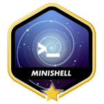
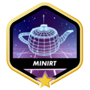

## 🔧 About Me

- 🎓 42 School alum (Perpignan)
- 🦀 Currently: transitioning C/C++ systems experience into Rust
- 🌊 Focus: securing legacy embedded C for maritime electronics via Rust/FFI — ahead of the EU Cyber Resilience Act (compliance deadline: Dec 2027)
- 📍 Based in Rennes, France

## 🚀 Current Project

**[`dashboard_NMEA_0183`](https://github.com/dansylvain/dashboard_NMEA_0183)** — a Rust TUI parsing NMEA 0183 marine navigation data, exploring Rust/C FFI to secure legacy sensor integration on boats.

## 🧰 Tech Stack

- **Primary:** Rust (ownership, FFI, `tokio`, `ratatui`)
- **Background:** C, C++ (42 curriculum — shells, HTTP servers, threading, Unix signals)
- Tools: Git, Linux, Arduino, Raspberry Pi

## 🎓 42 Foundations

## 🤝 Connect

- [LinkedIn](https://www.linkedin.com/in/dan-sylvain/)
